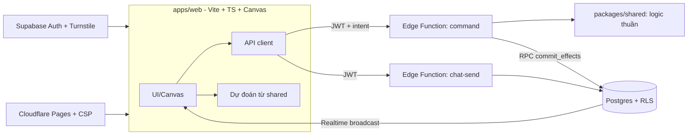

# 02 — Kiến trúc

## 1. Mục tiêu phi chức năng
| Mục tiêu | Cách đạt |
|---|---|
| Chống gian lận | Server-authoritative, RLS deny-by-default, idempotency, khóa lạc quan, ledger bất biến |
| Nhiều người chơi cùng lúc | Không tick server; tính tài nguyên "lười" theo mốc thời gian; realtime chỉ cho chat/presence |
| Chi phí 0đ | Supabase + Cloudflare Pages + GitHub Actions gói miễn phí; thiết kế tiết kiệm kết nối/ghi |
| Dễ vibe code | Logic thuần ở `packages/shared`, một cổng lệnh duy nhất, tài liệu/quy tắc rõ |
| Dễ thay thế | `ChatTransport` và `Repository` là interface |

> Giới hạn gói miễn phí (kết nối realtime, dung lượng DB, số lần gọi Edge Function, số project) **thay đổi theo thời gian** — kiểm tra trang giá hiện hành của Supabase/Cloudflare trước khi mở công khai và ghi con số vào `docs/adr/` khi chốt.

## 2. Sơ đồ tổng thể


## 3. Luồng một lệnh (ví dụ "bắt đầu lai tạo")
1. Client gửi `{ type:'breed.start', parentA, parentB, expected_version, idempotency_key }` kèm JWT.
2. Edge Function `command`: xác thực → zod → kiểm rate limit → kiểm quyền sở hữu → đọc trạng thái.
3. Gọi **hàm thuần** trong `packages/shared` với `clock` = giờ server và `rng` = RNG seed bởi server → trả về danh sách `Effect` (trừ tài nguyên, tạo job, ...) hoặc `GameError`.
4. Gọi RPC `commit_effects(planet_id, expected_version, effects, idempotency_key)`: một giao dịch DB kiểm `state_version`, áp hiệu ứng, ghi `resource_ledger`, tăng `state_version`. `CHECK` DB chặn số âm.
5. Trả về trạng thái mới (hoặc phần khác biệt). Client thay dự đoán bằng kết quả server.

Mẫu "Edge Function tính → RPC cam kết nguyên tử" cho phép viết logic bằng TypeScript chung với client mà vẫn có tính nguyên tử và ràng buộc ở DB (ADR-003).

## 4. Mô phỏng theo mốc thời gian (không tick)
- Mỗi bảng sản xuất lưu `(amount, rate_per_sec, updated_at, cap)`.
- Đọc: `amount_now = min(cap, amount + rate_per_sec × min(now − updated_at, offline_cap_sec))`.
- Mọi lệnh *chạm* tài nguyên trước hết "kết toán" (cập nhật `amount`, `updated_at`) rồi mới áp thay đổi.
- Job dài (lai tạo, xây, thăm dò) lưu `finish_at`; khi lệnh/đọc kế tiếp xảy ra hoặc khi người chơi mở game, server hoàn tất job có `finish_at ≤ now` (gọi là *lazy settlement*). Một cron nhẹ (pg_cron) chỉ cần dọn dẹp và gửi thông báo.
- Hệ quả: không cần worker chạy liên tục, chi phí gần 0, hợp gói miễn phí.

## 5. Tính xác định và ngẫu nhiên
- `Rng` seed theo `hash(server_secret, entity_id, action_counter)`. Người chơi không đoán/không reroll được; kết quả lưu ngay lần cam kết đầu tiên.
- Sinh hành tinh từ `seed` công khai nhưng chỉ server tạo seed; hàm sinh địa hình là hàm thuần có test snapshot.

## 6. Realtime
- Dùng Supabase Realtime **Broadcast** cho chat/presence nhẹ; tin nhắn đi qua Edge Function `chat-send` (kiểm tra, lọc, lưu DB) rồi mới phát. Client không được phát thẳng vào kênh.
- Chỉ subscribe kênh đang mở (hành tinh, liên minh, party, liên tinh). Presence chỉ cho liên minh/party/bạn bè, không toàn cục.
- `ChatTransport` interface: `send`, `subscribe`, `history`. Cài đặt đầu tiên bằng Supabase; thay bằng Cloudflare Durable Objects/WebSocket nếu vượt giới hạn.

## 7. Cấu trúc repo và phụ thuộc cho phép
```
apps/web           → phụ thuộc @tinh-hoa/shared, @supabase/supabase-js
packages/shared    → zod, fast-check(dev); KHÔNG phụ thuộc gì khác
supabase/functions → @tinh-hoa/shared (qua import map), supabase-js, zod
```
Danh sách thư viện đã duyệt: `vite`, `typescript`, `zod`, `@supabase/supabase-js`, `vitest`, `fast-check`, `eslint`, `prettier`, `playwright`, `lefthook`/`husky`, `@sentry/browser` (tùy chọn). Thêm thư viện khác cần hỏi.

## 8. Môi trường
| Môi trường | Supabase | Client | Dữ liệu |
|---|---|---|---|
| local | `supabase start` (Docker) | `pnpm dev` | seed giả |
| staging | project riêng | Cloudflare Pages preview | dữ liệu thử |
| production | project riêng | Cloudflare Pages production | thật |

Biến môi trường: `.env.local` (không commit); mẫu ở `.env.example`. Client chỉ nhận `VITE_SUPABASE_URL`, `VITE_SUPABASE_ANON_KEY`, `VITE_TURNSTILE_SITE_KEY`. Secret server đặt bằng `supabase secrets set`.

## 9. Quan sát và vận hành
- Mỗi request có `request_id` (UUID) đi suốt client → function → log.
- Số liệu theo dõi: lỗi function, độ trễ `command`, số `cheat_flags`, dung lượng DB, số kết nối realtime, số tin chat/phút.
- Backup: dump định kỳ (`supabase db dump`) lưu ngoài repo, thử khôi phục hàng quý.

## 10. Feature flag
Bảng `feature_flags(key, enabled, rollout_percent)`; client và server đọc. Dùng để bật dần chat, liên minh, chiến tranh, và **tắt khẩn cấp** khi có lỗ hổng.

## 11. ADR (Architecture Decision Records)
Lưu ở `docs/adr/NNNN-tieu-de.md` theo mẫu: Bối cảnh / Quyết định / Hệ quả / Phương án đã loại. Các ADR cần có ngay ở P0:
- ADR-001: Chọn Supabase + Cloudflare Pages (so sánh với Cloudflare Workers + Durable Objects + D1).
- ADR-002: Server-authoritative + mô phỏng theo mốc thời gian.
- ADR-003: Edge Function tính, RPC `commit_effects` cam kết nguyên tử.
- ADR-004: `ChatTransport` trừu tượng.
- ADR-005: Monorepo pnpm workspaces.

## 12. Khi nào phải rời gói miễn phí
Dấu hiệu: kết nối realtime chạm trần, DB gần đầy, hàm vượt hạn mức. Phương án theo thứ tự: giảm tần suất ghi/xóa tin cũ → chuyển chat sang Durable Objects → nâng gói trả phí khi đã có nguồn thu. Đừng tối ưu sớm trước khi có số liệu.
